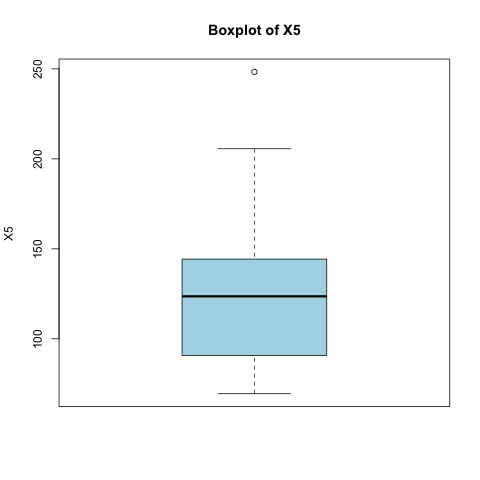
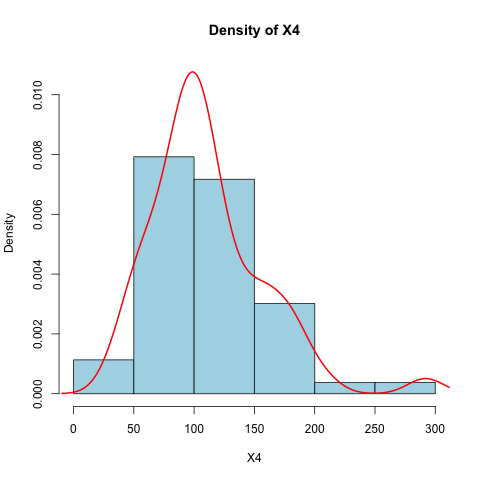
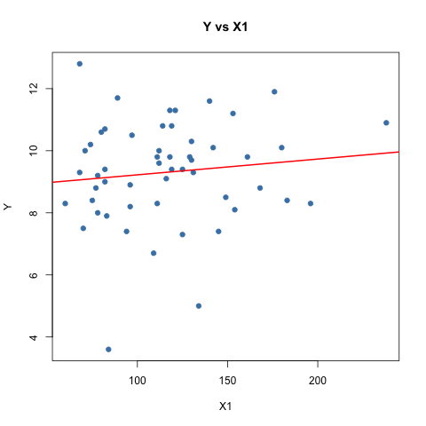

# First Project in R

An introductory project in R: loading a dataset, computing descriptive statistics, plotting distributions and fitting a simple linear regression. It is based on Exercise Sheet 1, Question 6 of a statistics course.

**Data:** `Exc1.csv`, 53 rows with 5 numeric columns: `Y`, `X1`, `X2`, `X3`, `X4`.
**Script:** `פרויקט ראשוני בשפת R.R`. Each section runs on its own: select it and press *Run Code*.

## Questions and results

| # | Question | R function | Result |
|---|----------|-----------|--------|
| 1 | Median of X2 | `median()` | **525** |
| 2 | Correlation between X3 and Y | `cor()` | **r = -0.172** |
| 3 | Add column X5 = X1 + X3 | `data$X5 <- ...` | e.g. row 1: 78 + 9.1 = **87.1** |
| 4 | BoxPlot of X5, including outliers | `boxplot()`, `summary()` | Q1 = 90.8, median = 123.6, Q3 = 144.3; **one outlier: 248.3** |
| 5 | Density of X4 with a density line | `hist(freq = FALSE)`, `density()` | Peak around 100, long right tail up to 292 |
| 6 | Simple regression, Y on X1 | `lm()`, `summary()`, `abline()` | **Ŷ = 8.716 + 0.00508·X1** |

**Section 6 in detail:**

| Coefficient | Estimate | t value | p-value |
|---|---|---|---|
| Intercept (β₀) | 8.716 | 11.70 | < 0.001 |
| X1 (β₁) | 0.00508 | 0.83 | 0.409 |

R² = 0.013

## Plots

| BoxPlot of X5 | Density of X4 | Y vs X1 with regression line |
|---|---|---|
|  |  |  |

## Conclusions and insights

- **X3 and Y are almost unrelated.** r = -0.17 is a weak, slightly negative correlation.
- **X5 is right-skewed.** The mean (125.5) is above the median (123.6), and the upper whisker is longer. The only outlier, 248.3, lies above the upper fence Q3 + 1.5·IQR = 224.55. The second-highest value, 205.6, is the end of the whisker, not an outlier.
- **X4 is also right-skewed.** Most values are between 50 and 150, with a few large values up to 292. The mean (110.6) is above the median (103).
- **X1 does not explain Y.** The slope is tiny and not significant (t = 0.83, p = 0.41), and X1 explains only about 1.3% of the variance in Y. The scatter plot shows a cloud of points around an almost flat line. Only the intercept is significant, which simply says that the average Y (about 9) is far from zero.

## What I learned about R

- `data$column` selects a column, and `<-` stores a value. Assigning to a new column creates it.
- Arithmetic on columns is vectorized: it runs row by row with no loop.
- An R session has memory. A line only works if the lines it depends on (such as loading the data) already ran.
- `lm(Y ~ X)` fits a regression, and `summary()` gives the coefficients, t values, p-values and R².
- Code Runner (`Rscript`) has no plot window, so plots are saved with `png()` and `dev.off()` and then opened.
